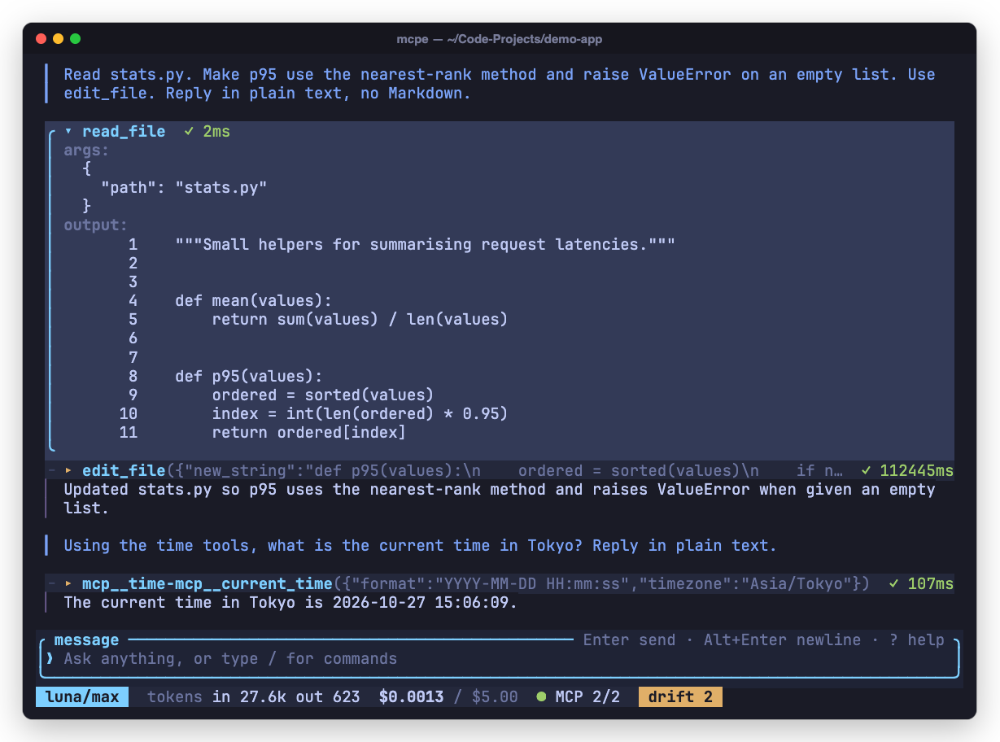
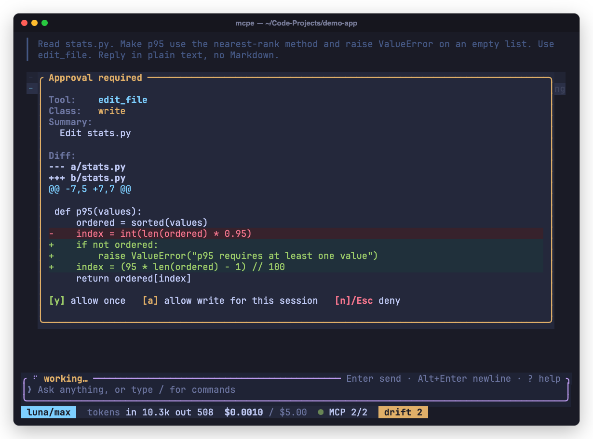
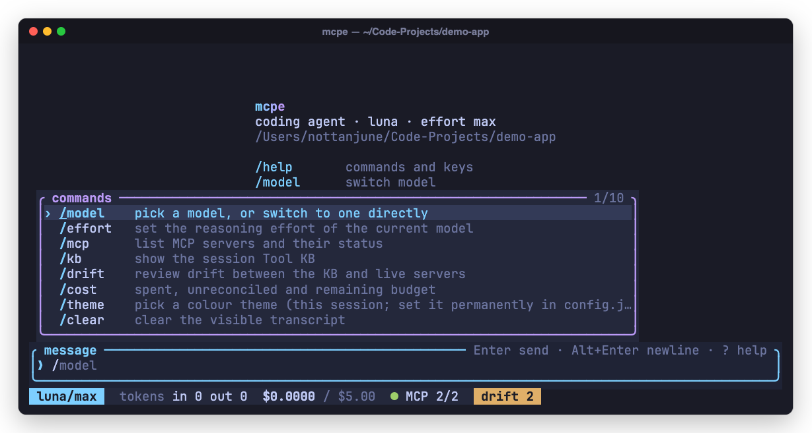
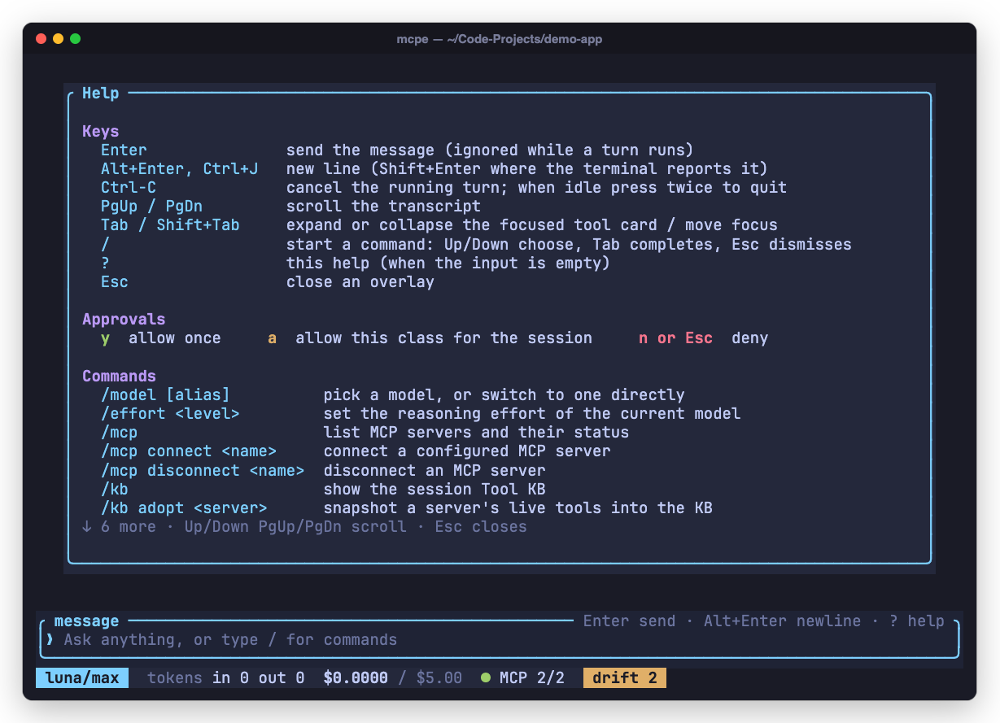
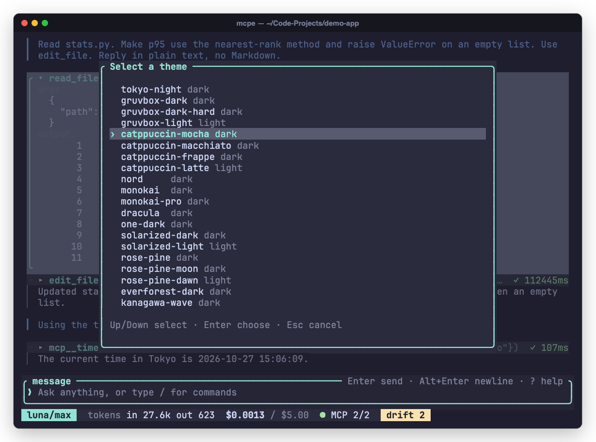
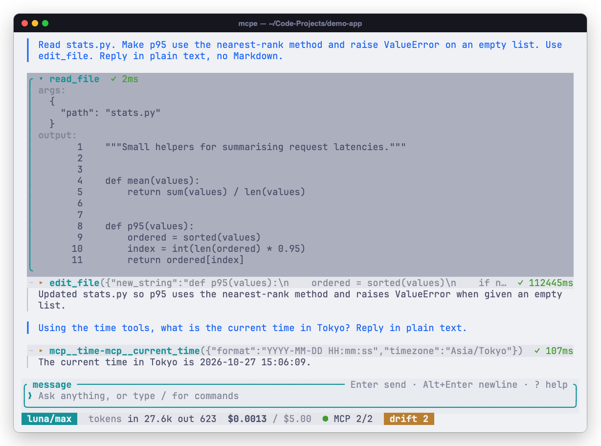
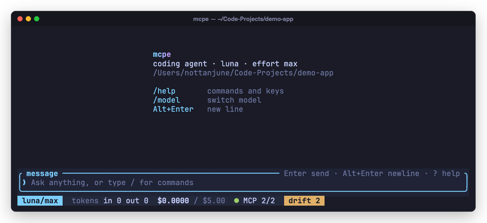
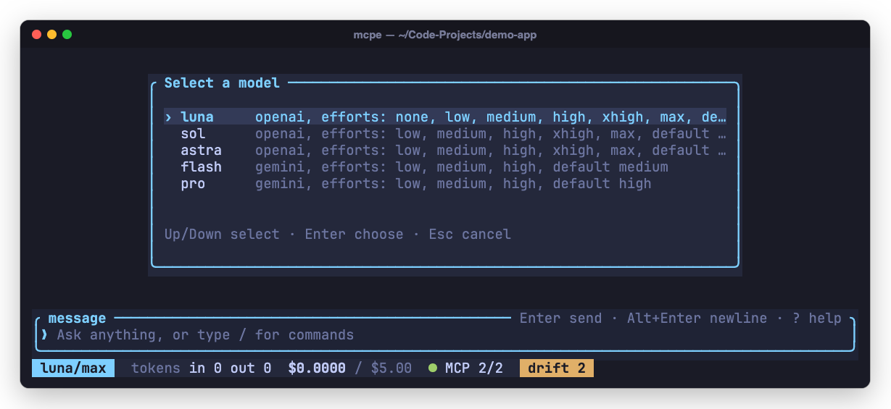
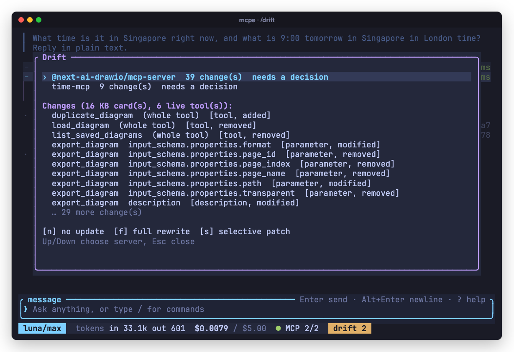
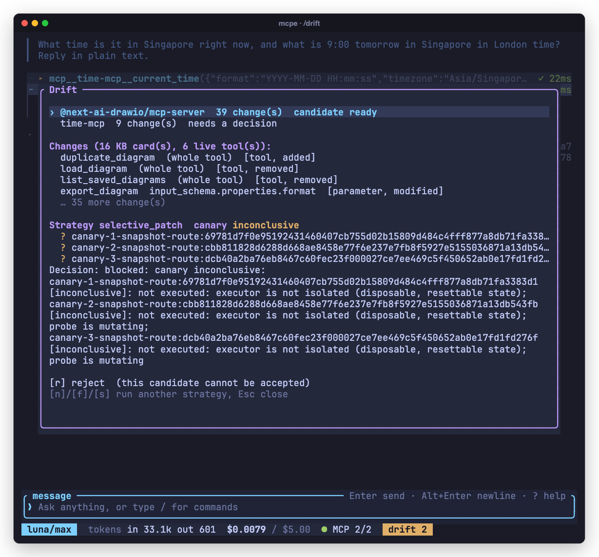

# MCP tool-knowledge adaptation harness

AI6101 Group Project 3: tool harness adaptation under environment change.

When MCP servers evolve, an agent's tool knowledge goes stale. This project asks whether updating
only the stale parts (**selective patch**) recovers task performance at lower cost than keeping
the old knowledge (**no update**) or regenerating all of it (**full rewrite**). We test this on
[MCPEvol-Bench](https://github.com/Octobrist/MCPEvol-Bench) at three server versions: Early
(`original`), Middle (`iter3`) and Late (`iter5`).

The project has two parts:

- **Rust harness** (`crates/`): a Tool KB model, a drift detector, the three strategies, candidate
  validation, a canary gate, a cost ledger, and the `mcpe` terminal agent (Ratatui TUI) that shows
  drift live and lets the user accept or reject a patch.
- **Python benchmark** (`benchmark/`): the teammate's MCPEvol-Bench agent and judge, imported from
  [`Sneha421/MCPEvol-Bench`](https://github.com/Sneha421/MCPEvol-Bench) and connected to the Rust
  harness through a process runner.

Report: [`docs/report/report.pdf`](docs/report/report.pdf).

## How selective patch works

1. Capture each server's live `tools/list` as a Tool KB (one card per tool).
2. Diff the source KB against the target and classify each change as Tool-, Parameter- or
   Description-level.
3. Send only the affected cards to the model, in batches of 12. The harness copies structure
   (`tool_id`, `name`, schemas) from the target; the model writes only descriptions and usage rules.
4. Validate the candidate. Unchanged cards must stay byte-identical.
5. Run a canary of targeted and control probes. Promote the candidate only if it passes.

## Terminal agent (`mcpe`)

`mcpe` is a terminal coding agent built on Ratatui. It reads, edits and writes files, runs shell
commands, and calls MCP tools. Writes and shell commands wait for approval, and the approval modal
shows the exact diff. It also connects to live MCP servers, flags drift against its stored Tool
KB, and lets the user review a patch before it is promoted. All screenshots come from live
sessions.

<table>
  <tr>
    <td width="50%"><br><sub>Agent session. Tool cards show arguments, output and latency; Tab expands them.</sub></td>
    <td width="50%"><br><sub>Approval modal. Allow once, allow the class for the session, or deny.</sub></td>
  </tr>
  <tr>
    <td><br><sub>Typing <code>/</code> opens the command palette with completion.</sub></td>
    <td><br><sub><code>?</code> opens the help overlay.</sub></td>
  </tr>
  <tr>
    <td><br><sub><code>/theme</code> previews 20 built-in themes live.</sub></td>
    <td><br><sub>The same session in <code>catppuccin-latte</code>.</sub></td>
  </tr>
  <tr>
    <td><br><sub>Welcome screen and status bar: model, tokens, cost against the cap, MCP servers, drift.</sub></td>
    <td><br><sub><code>/model</code> switches between OpenAI and Gemini models mid-session.</sub></td>
  </tr>
  <tr>
    <td><br><sub><code>/drift</code> lists Tool-, Parameter- and Description-level changes on real <code>iter5</code> drift.</sub></td>
    <td><br><sub>A selective patch candidate and its canary decision.</sub></td>
  </tr>
</table>

## Results

There are two experiments, run on the same 20 tasks and the same Python agent and judge:

- **Pilot (Python):** the teammate's original run. The strategies are implemented in Python
  (`benchmark/src/custom/real_mcp/selective_patch_runner.py`), and full rewrite copies the
  current server's tool definitions without a model call.
- **Live (Rust):** this harness. The Rust strategies (`crates/harness-core/src/strategy.rs`)
  build each KB from the real servers' `tools/list`, and full rewrite uses the model to rewrite
  every card. The Rust pipeline passes the promoted KB to the Python runner through `--tool-kb`.

Each experiment ran 20 tasks with `gpt-6-luna` as agent and judge, one run per task, and five
judgments per run. TF and PE are judge scores on a 1 to 10 scale. ECS is the mean TF across the
three versions minus its spread.

| Strategy | Pilot ECS (Python) | Live ECS (Rust) | Live adaptation calls (Middle / Late) | Live adaptation USD (Middle + Late) |
|---|---:|---:|---:|---:|
| No update | 5.643 | 6.093 | 0 / 0 | 0.000 |
| Selective patch | **5.740** | 6.121 | **5 / 7** | **0.034** |
| Full rewrite | 5.306 | **6.208** | 39 / 39 | 0.065 |

- **Performance:** in the pilot, selective patch ranks first. In the live run, all three
  strategies are within run-to-run noise. Every paired 95% bootstrap interval includes zero.
- **Cost:** selective patch adapts with 41% (Middle) and 65% (Late) of full rewrite's cost, and
  leaves all 240 to 252 unchanged cards untouched.
- **Recovery:** on live tasks whose tools changed, Late PE rises from 7.09 (no update) to 9.11
  (selective patch), because calls are no longer built from stale parameters.
- **Failure modes:** under-update (a `start_session` prerequisite lost from a description, task
  229) and over-update (full rewrite disturbing working behavior, task 281).

The full live run (180 judged task runs) cost about USD 1.41. Tables:
[`benchmark/reports/live/summary.md`](benchmark/reports/live/summary.md). Pilot audit:
[`docs/benchmark-results.md`](docs/benchmark-results.md).

## Repository layout

| Path | Contents |
|---|---|
| `crates/harness-core` | Tool KB, diff, strategies, validation, canary, cost ledger, runner bridge, pipeline |
| `crates/harness-agent` | OpenAI and Gemini clients, MCP client, agent loop, live canary |
| `crates/harness-tui` | Ratatui interface: chat, `/drift` view, patch review |
| `crates/harness-cli` | Binaries `harness` (headless `validate` and `run`) and `mcpe` (terminal agent) |
| `benchmark/` | Python agent and judge, process runner (`integration/`), raw results (`reports/`) |
| `configs/live/` | The exact Early, Middle and Late configs used for the live run |
| `schemas/` | `tool-kb/1` and `run-event/1` JSON Schemas shared by Rust and Python |
| `fixtures/` | Offline smoke and contract fixtures |
| `docs/` | Report, experiment protocol, results notes, usage reference |

## Quick start

Requires Rust 1.98.0 (pinned in `rust-toolchain.toml`), Python 3.11 to 3.13, and `uv`.

```sh
# Build and test
cargo fmt --all -- --check
cargo clippy --workspace --all-targets --all-features -- -D warnings
cargo test --workspace --all-features
uv sync --project benchmark --locked
benchmark/.venv/bin/python -m unittest discover -s benchmark/tests -v

# Offline smoke run (mock provider, no network)
cargo run -p harness-cli -- run --config fixtures/smoke.toml --output target/harness-smoke

# Terminal agent
cargo install --path crates/harness-cli --bin mcpe
export OPENAI_API_KEY=...        # or GEMINI_API_KEY
mcpe                             # inside: /drift, then n / f / s to adapt, a / r to accept or reject
```

## Reproducing the live experiment

The live run needs the evolved server bundles (about 1 GB each, from
`anonymous2233/evol-servers` on Hugging Face) unzipped under `benchmark/servers/`, Node.js for
1MCP 0.38.3, and an OpenAI key in `OPENAI_ETHICS_KEY`.

```sh
benchmark/integration/capture_all.sh original iter3 iter5     # live tool listings
benchmark/integration/run_all_live.sh target/live/runs/full   # all stages, then ECS
benchmark/.venv/bin/python benchmark/integration/live_report.py \
  --runs target/live/runs/full --out benchmark/reports/live    # report tables
```

Setup steps and the defects fixed while connecting the live path are in
[`benchmark/INTEGRATION.md`](benchmark/INTEGRATION.md#live-run-against-the-real-server-versions).

## Reproduction material

| Item | Location |
|---|---|
| Configs | `configs/live/{early,middle,late}.toml` |
| Run logs (`run-event/1` JSONL), KBs, trajectories, judgments | `benchmark/reports/live/runs/` |
| Captured tool listings | `benchmark/reports/live/tool-listings/` |
| Recovery and retention analysis | `benchmark/reports/live/analysis/` |
| Historical pilot results | `benchmark/src/custom/data/benchmark_clean_r{1,2}/`, audit in `benchmark/reports/verified-results.*` |

## Limitations

- One agent run per task. The brief prefers three, and none of the performance differences are
  statistically significant.
- No state-based completion verifier. Task completion rests on the LLM judge.
- Server state was not reset between runs. Files written by tools are archived in
  `benchmark/reports/live/tool-side-effects/`.
- The canary checks schema compatibility only; it cannot test description-only changes.

## More documentation

- [`docs/usage.md`](docs/usage.md): CLI flags, configuration, TUI themes, output layout, schemas,
  security.
- [`docs/experiment-protocol.md`](docs/experiment-protocol.md): protocol, stage mapping, event
  contract.
- [`benchmark/INTEGRATION.md`](benchmark/INTEGRATION.md): Rust and Python integration.
